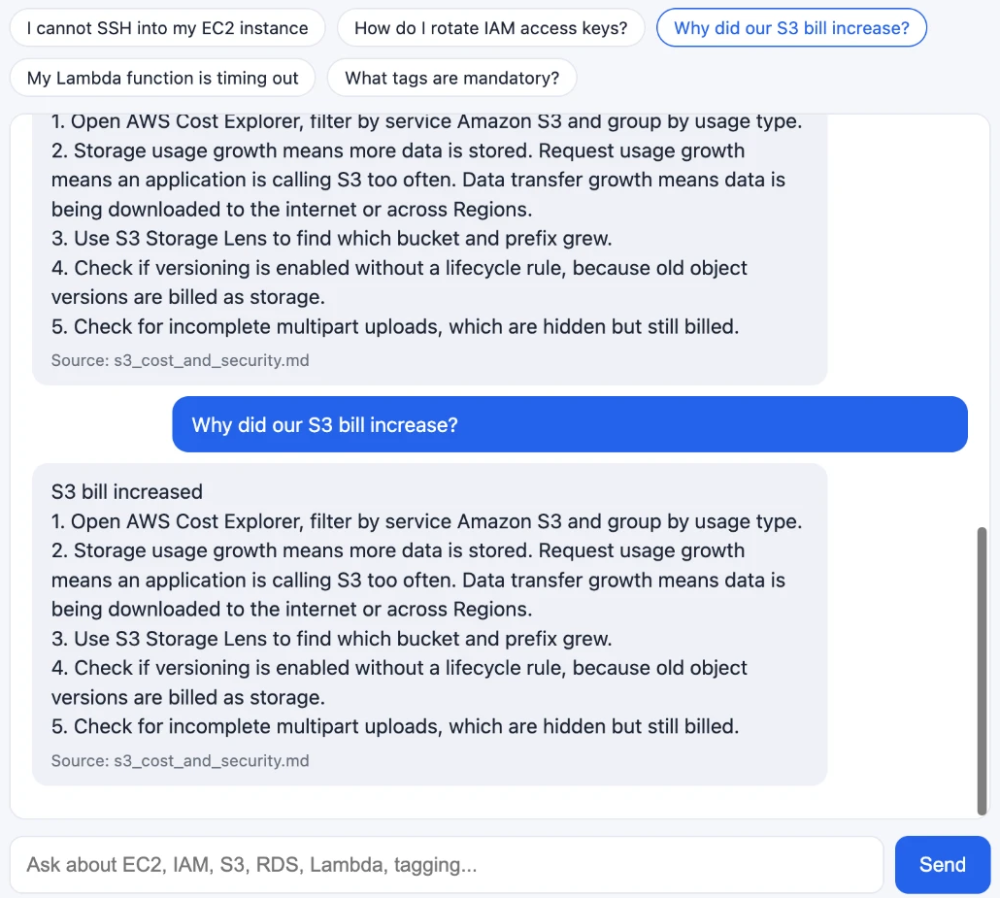

# AWS CloudOps Assistant: a RAG chatbot for cloud admins

A chatbot that helps AWS administrators troubleshoot everyday issues (EC2, IAM, S3, RDS, Lambda, tagging and cost) by answering from the team's own runbooks, with the source runbook cited for every answer.



## Example questions
- I cannot SSH into my EC2 instance
- How do I rotate IAM access keys?
- Why did our S3 bill increase?
- My Lambda function is timing out
- How do I restore an RDS database?
- Someone leaked an access key on GitHub

## Architecture
```
Browser (web/index.html)
   │  POST {"question": "..."}
   ▼
Lambda Function URL ──> AWS Lambda (Python)
                          │ 1. retrieve  ──> Bedrock Knowledge Base ──> matching runbook sections
                          │ 2. converse  ──> Amazon Nova Lite ──> step-by-step answer
                          ▼
                 {"answer": "...", "sources": ["ec2_troubleshooting.md"]}

Runbooks in S3 ──> Titan Text Embeddings ──> vector store (managed by the Knowledge Base)
```
If the chat model is unavailable, the Lambda falls back to returning the best-matching runbook section, and says "not found" instead of guessing.

## Tech stack
Amazon Bedrock Knowledge Bases, Titan Text Embeddings, Amazon Nova Lite, AWS Lambda (Python, Boto3), Lambda Function URL, Amazon S3, IAM, CloudWatch Logs, HTML/JavaScript

## Project structure
```
runbooks/                   6 sample runbooks loaded into the Knowledge Base
lambda/lambda_function.py   Lambda backend (retrieve + converse + fallback)
web/index.html              Chat page that calls the Function URL
screenshots/                Demo screenshot
```

## Setup
1. Upload the files in `runbooks/` to an S3 bucket.
2. Create a Bedrock Knowledge Base on that bucket and **Sync** it.
3. Create a Lambda function (Python 3.12) with `lambda/lambda_function.py`, set `KB_ID` and `MODEL_ID=amazon.nova-lite-v1:0`, and a 30-second timeout.
4. Give the Lambda role `bedrock:Retrieve` and `bedrock:InvokeModel`.
5. Create a Function URL (CORS: allow origin `*`, method POST).
6. Open `web/index.html` and paste the Function URL.

## Auto-sync pipeline (CI/CD)
Runbooks live in this repo. Pushing a change to `runbooks/` updates the chatbot automatically:
```
git push (runbooks/**) ──> GitHub Actions
                             1. Log in to AWS with OIDC (no stored access keys)
                             2. aws s3 sync runbooks/ → S3 bucket (--delete removes deleted runbooks)
                             3. bedrock-agent start-ingestion-job → Knowledge Base re-syncs
                             4. Wait until the sync is COMPLETE
```
- Workflow: `.github/workflows/sync-runbooks.yml`
- IAM permissions for the GitHub role: `iam/github-actions-permissions.json` (least privilege: one bucket, one Knowledge Base)
- Repo variables: `AWS_ROLE_ARN`, `AWS_REGION`, `S3_BUCKET`, `KB_ID`, `DATA_SOURCE_ID`

## Future improvements
- Add live AWS checks (for example, read a security group's rules with Boto3) alongside the runbook answers
- Login with Amazon Cognito
- Slack integration for the on-call team

## Cleanup
Delete the Function URL, Lambda, Knowledge Base **and its vector store**, and the S3 bucket when finished.
